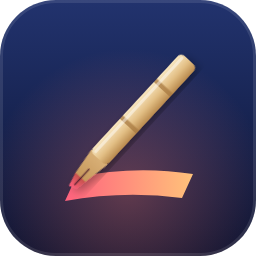

<div align="center">



# BP MD RTL Reader

**A local-first Markdown reader and editor for Windows and Linux, with first-class right-to-left support for Arabic.**

Opens plain `.md` files from disk. No account, no telemetry, no proprietary format.

English | [العربية](README.ar.md)

[](LICENSE)
[](#download)
[](https://github.com/Binary-Parse/BP-MD-RTL-Reader/releases)
[](CHANGELOG.md)


</div>

## Why BP MD RTL Reader

Most Markdown tools treat right-to-left languages as an afterthought: one global "RTL mode", or nothing at all.
This app detects direction for each block.
In a note that mixes Arabic prose with English code, every paragraph renders in its own direction.

## Features

- **Right-to-left done right.** Direction is detected per block, and you can pin it per block or per note.
- **Reading mode and Edit mode.** Read a note as a page, or edit it with a live preview.
- **Folders and tabs.** Open several folders at once, work in tabs, and search across a folder.
- **Rich Markdown.** Callouts, tables, task lists, KaTeX math, Mermaid diagrams, code highlighting, and `[[wiki-links]]`.
- **Highlights and margin notes.** Mark passages as you read, and pick up where you left off.
- **Four themes and an Arabic interface.** Paper, Ink, Sepia, and Oasis themes, a full Arabic interface, a Hijri calendar, and kashida justification.
- **Export.** Save a note as PDF, HTML, or EPUB.
- **Faithful saves.** Files keep their own encoding, byte-order mark, and line endings.
- **Works offline.** Everything the app needs ships inside it.

|  Ink (dark)  |  Sepia  |  Edit mode  |  Command palette  |
| :----------: | :-----: | :---------: | :---------------: |
|  |  |  |  |

## Download

Get the latest build from the [Releases page](https://github.com/Binary-Parse/BP-MD-RTL-Reader/releases).

| Your system | Recommended file | Notes |
| ----------- | ---------------- | ----- |
| Windows 10 or 11 | `…-Windows-NSIS-multiarch.exe` | Installer for x64 and ARM64 |
| Windows, no install | `…-Windows-Portable-multiarch.exe` | Runs from any folder |
| Linux (Debian, Ubuntu) | `…-Linux-amd64.deb` or `…-Linux-arm64.deb` | Preferred on Linux |
| Linux (other) | `…-Linux-x86_64.AppImage` or `…-Linux-arm64.AppImage` | Runs without installing |
| **macOS** | — | Not built and not tested |

An Inno Setup installer (`…-Windows-Inno-x64.exe`, x64 only) is also published.
ARM64 builds were not tested on ARM64 hardware.
See [docs/INSTALL.md](docs/INSTALL.md) for every package and the install and uninstall steps.

> [!IMPORTANT]
> **The files are not code-signed.** Windows shows "Windows protected your PC" (SmartScreen) for an unsigned installer.
> Check the file against the release checksums first, then choose **More info**, then **Run anyway**.

### Verify your download

Every release includes `SHA256SUMS.txt`.
The hash of your file must match the hash listed for that file.

```powershell
(Get-FileHash .\BP-MD-RTL-Reader-2.1.0-Windows-NSIS-multiarch.exe -Algorithm SHA256).Hash
```

```bash
sha256sum --check --ignore-missing SHA256SUMS.txt
```

A checksum proves the file is the one that was published.
It does not replace a signature.
Releases are built by hand, so there is no automated build-provenance attestation.

## Quick start

1. Install the app and start it. It opens on a welcome screen.
2. Press `Ctrl+O` to open a file, or `Ctrl+Shift+O` to open a folder. To try it first, choose **Try Demo**.
3. Press `Ctrl+E` to switch between Reading mode and Edit mode, and `Ctrl+K` for the command palette.

## Documentation

Start with the [documentation index](docs/README.md).

- [Getting started](docs/GETTING_STARTED.md): a first walk through the app.
- [User guide](docs/USER_GUIDE.md): how to do each task.
- [Keyboard shortcuts](docs/KEYBOARD_SHORTCUTS.md): the full list. In the app, press `Ctrl+/`.
- [Markdown syntax](docs/MARKDOWN_SYNTAX.md): what the app renders.
- [Right-to-left text](docs/RTL.md): how direction detection works.
- [Troubleshooting](docs/TROUBLESHOOTING.md): fixes for common problems.
- [Build from source](docs/BUILD.md) and [architecture](docs/ARCHITECTURE.md): for contributors.
- [Changelog](CHANGELOG.md): what changed in each version.

## Privacy at a glance

- Your notes stay in your own `.md` files. There is no account, no telemetry, and no crash upload.
- The app makes no network request unless you turn on the optional update check. It is off by default.
- When it is on, it asks GitHub for the latest release when the app starts and then daily while it runs. It sends no note content and never downloads anything.

Details are in [docs/PRIVACY.md](docs/PRIVACY.md).

## Contributing, security, and license

- Bug reports, test cases, and patches are welcome through issues (pull requests are turned off). Read [CONTRIBUTING.md](CONTRIBUTING.md). Everyone taking part follows the [Code of Conduct](CODE_OF_CONDUCT.md).
- To report a security problem, use GitHub's private vulnerability reporting. Do not open a public issue. See [SECURITY.md](SECURITY.md).
- Released under the [MIT License](LICENSE). Copyright 2026 Binary Parse Co. Third-party components are listed in [THIRD-PARTY-NOTICES.md](THIRD-PARTY-NOTICES.md).
