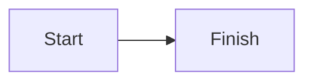

# Markdown syntax

This page lists the Markdown that BP MD RTL Reader renders, with examples you can paste into a note. It also lists the limits on parsing.

The app renders GitHub-flavored Markdown, plus a few extras. Everything it renders is sanitized first, so a note cannot run code.

## Contents

- [Basic Markdown](#basic-markdown)
- [Extra inline formatting](#extra-inline-formatting)
- [Tables](#tables)
- [Callouts](#callouts)
- [Math](#math)
- [Diagrams with Mermaid](#diagrams-with-mermaid)
- [Code blocks](#code-blocks)
- [Footnotes](#footnotes)
- [Front matter](#front-matter)
- [Wiki-links and tags](#wiki-links-and-tags)
- [Images](#images)
- [Block direction pins](#block-direction-pins)
- [Parsing limits](#parsing-limits)

## Basic Markdown

These work as in GitHub-flavored Markdown:

- Headings `#` to `######`
- **Bold**, *italic* and ~~strikethrough~~
- Bulleted, numbered and task lists (`- [ ]` and `- [x]`)
- Blockquotes
- Links and images
- Horizontal rules
- Inline code and fenced code blocks
- Tables

A single line break inside a paragraph shows as a line break. You do not need two trailing spaces.

Raw HTML is allowed, but the app strips scripts, event handlers and other active content. Opening a hostile `.md` file cannot run code.

## Extra inline formatting

| You type | You get |
| -------- | ------- |
| `==highlight==` | Highlighted text. The text after `==` must not start with a space, so `a == b` stays plain |
| `<u>underline</u>` | Underlined text |
| `H~2~O` | Subscript |
| `X^2^` | Superscript. No spaces inside |

## Tables

```markdown
| Name | Score |
| :--- | ----: |
| Ali  | 10    |
| Sara | 12    |
```

`:--` aligns a column to the start of the cell, `--:` to the end and `:-:` to the center. In a right-to-left table, the start is the right side. See [Work with tables](USER_GUIDE.md#work-with-tables).

## Callouts

A callout is a blockquote whose first line is a type in brackets, with an optional title:

```markdown
> [!WARNING] Back up first
> This step overwrites the file.
```

The types are `note`, `tip`, `important`, `warning`, `caution` and `info`. The type is not case-sensitive. A blockquote with any other type stays a plain blockquote.

With no title, the callout shows its type as the title. In a callout written in Arabic, that title is Arabic. Callouts follow the direction of their own text.

## Math

Use `$…$` for inline math and `$$…$$` for display math. The math is rendered with KaTeX, always left-to-right, even inside Arabic text.

```markdown
Inline: $E = mc^2$

Display: $$\int_0^1 x^2\,dx = \tfrac{1}{3}$$
```

An opening `$` must be followed by a non-space, and the closing `$` must follow a non-space. So "$5 and $10" is currency, not math. Math inside code spans and code blocks is not rendered.

## Diagrams with Mermaid

Put the diagram in a fenced block with the language `mermaid`:

````markdown

````

The diagram is drawn left-to-right and never flips with the note. If the diagram has an error, or takes longer than about 8 seconds, the app shows the source as a code block with the message "Diagram could not be rendered — showing its source".

## Code blocks

Fenced code blocks get syntax highlighting when you name a language after the opening fence. Without a language, the app guesses from a common set. Code blocks always stay left-to-right, even in an Arabic note, and you cannot pin their direction.

## Footnotes

```markdown
This claim needs a source.[^1]

[^1]: The source goes here.
```

Footnotes are numbered in the order they are first used. The definitions appear at the end of the note, each with a link back.

## Front matter

A note can start with a block of `key: value` lines between two `---` lines:

```markdown
---
direction: rtl
lang: ar
---
```

The app reads two keys:

| Key | Values | Effect |
| --- | ------ | ------ |
| `direction` | `rtl` or `ltr` | Forces the direction of the whole note. See [Right-to-left text](RTL.md#how-direction-is-decided) |
| `lang` | A language tag such as `ar`, `fa`, `ur` or `he` | Tells screen readers the language of the note |

The front matter is hidden in Reading mode. Other keys are kept in the file and ignored. Only simple one-line keys count. Indented lines belong to nested structures and are ignored. A note that starts with a `---` rule and has another `---` later is not front matter unless the lines between look like YAML.

## Wiki-links and tags

- **Wiki-link.** `[[Note title]]` links to another note by file name. `[[Note title|text to show]]` shows other text. Click to jump. See [Link notes with wiki-links](USER_GUIDE.md#link-notes-with-wiki-links).
- **Tag.** `#tag` anywhere in prose. A tag starts after a space or the start of a line. It can hold letters, numbers, `_` and `-`, in any script. `#123` and colors such as `#fff` are not tags. Code and math are skipped.

## Images

Images display in two cases:

- **A file next to the note.** A relative path such as `` works for a note opened from a folder. The file must be inside that folder. A path that climbs out of it does not load.
- **A data URI.** `` works anywhere.

Remote images never display. A link such as `` is blocked by the app's content policy. This is deliberate, so a note cannot make your computer contact a server. A note opened with **Open File** has no folder, so its relative images do not load either.

If a relative image is missing, the app shows a placeholder that names the path.

Exports keep only embedded images. Every other image becomes `[Image: alt text]`.

## Block direction pins

A line `<!-- dir: rtl -->` or `<!-- dir: ltr -->` directly above a block pins that block's direction. Other Markdown apps hide it. The app writes it for you. See [Set the direction of one block](USER_GUIDE.md#set-the-direction-of-one-block).

## Parsing limits

The app limits how much work it does on one piece of text. This keeps a huge or broken note from freezing the window.

| Limit | What happens past it |
| ----- | -------------------- |
| Math over 32 KB | Shown as plain text, with its `$` signs |
| Code block over 256 KB | Shown without syntax colors |
| A line over 5,000 characters, in Edit mode | The editor keeps the raw Markdown for that line instead of previewing it |
| A very long or deeply nested note | Part of the note is shown as plain text, with the message "Part of this note is shown as plain text, because formatting it would take too long" |
| Notes over 5 MB | Large-file behavior. See [Size tiers](FILES_AND_LIMITS.md#size-tiers) |
