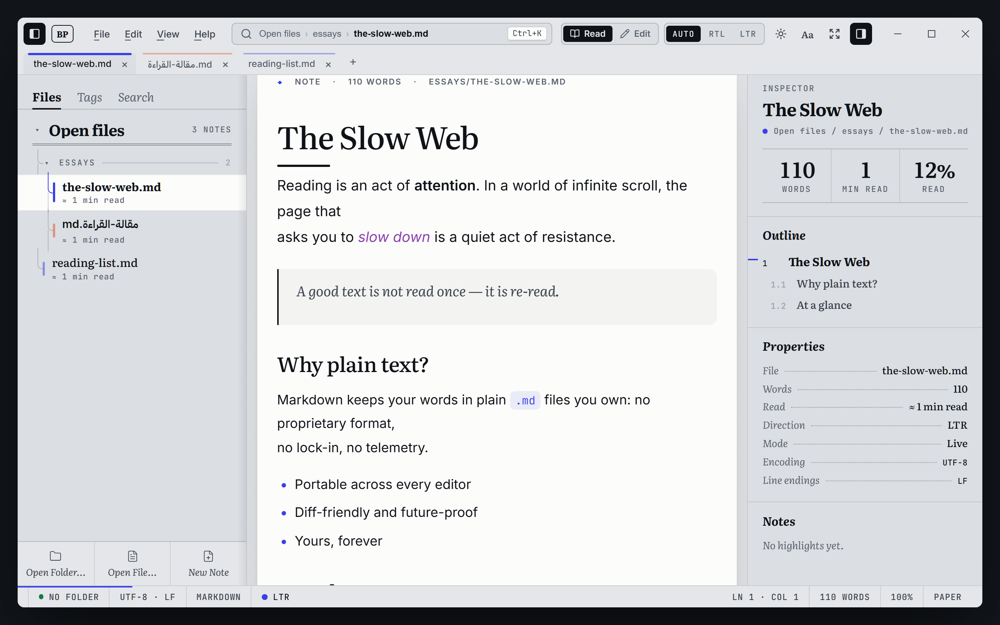
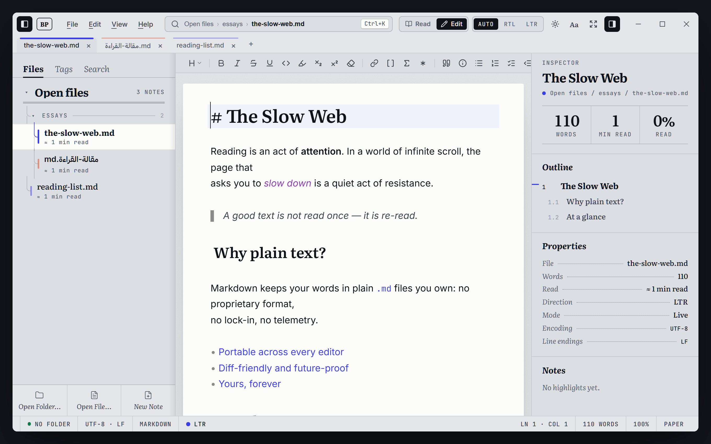
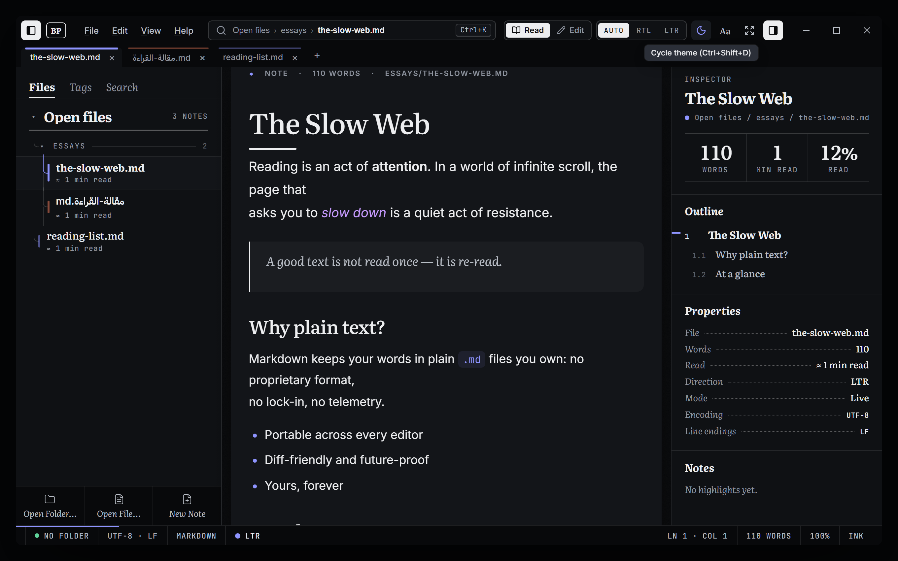
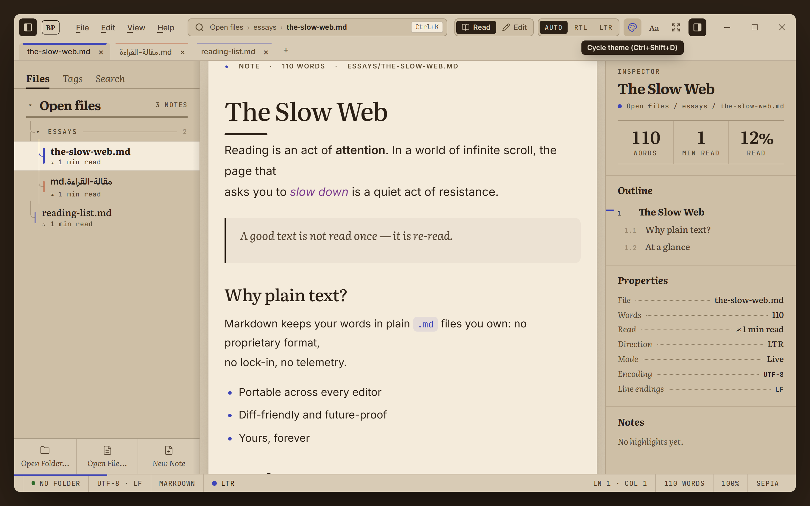
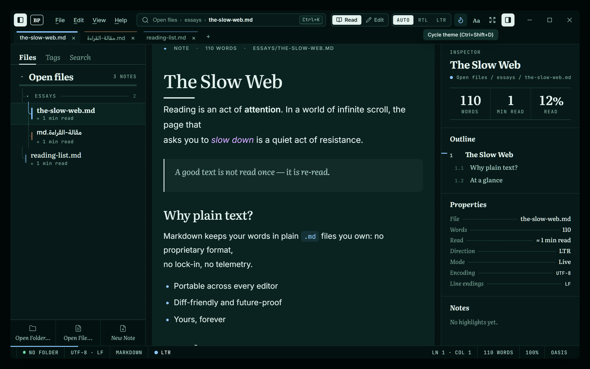
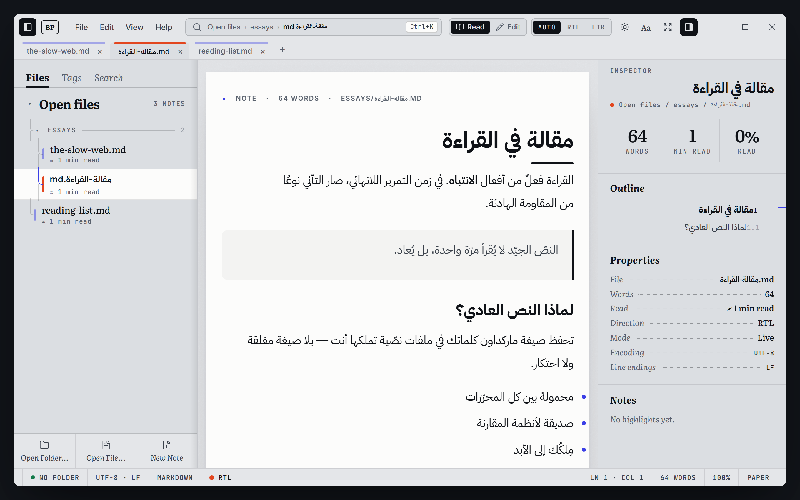
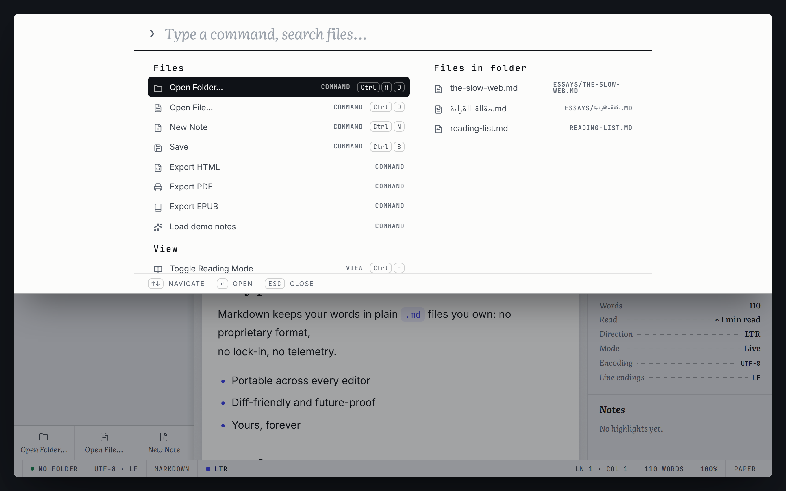

# User Guide

This guide describes the features of **BP MD RTL Reader**. For the full key list see
[Keyboard Shortcuts](KEYBOARD_SHORTCUTS.md); for privacy details see
[Privacy & Security](PRIVACY.md).

## Contents

- [The window at a glance](#the-window-at-a-glance)
- [Opening your notes](#opening-your-notes)
- [The editor](#the-editor)
- [Writing & formatting](#writing--formatting)
- [Themes](#themes)
- [Arabic & right-to-left](#arabic--right-to-left)
- [Finding things](#finding-things)
- [Tags & wiki-links](#tags--wiki-links)
- [The inspector](#the-inspector)
- [Creating & exporting](#creating--exporting)
- [What gets remembered](#what-gets-remembered)

---

## The window at a glance

| Area | What it does |
| ---- | ------------ |
| **Title bar** | Two rows. The top row holds the sidebar toggle, the **BP** mark (opens About), the menu bar (File · Edit · View · Help), a search field that shows where you are (`library › folder › note`) and opens the command palette, the Read/Edit switch, the direction switch (Auto · RTL · LTR), the theme button, the **Aa** reading controls, fullscreen, the inspector toggle and the window controls. The second row holds your open tabs. Both rows can be auto-hidden — see **Settings** below. |
| **Sidebar** (left) | Three tabs — **Files** (your folder tree, with read time and progress for each note), **Tags**, and **Search**. Three buttons at the foot open a folder, open a file or start a new note. Toggle with `Ctrl+\` or the panel button at the far left of the title bar. |
| **Tab row** | One tab per open file; a `●` marks unsaved changes and a small colour tick at the top shows the note's direction (blue left-to-right, red right-to-left). The `+` opens a new note. |
| **Read / Edit and direction** | Click **Read** or **Edit** to see which mode you are in (`Ctrl+E` flips it); the direction switch shows Auto, RTL or LTR and cycles with `Ctrl+Shift+L`. |
| **Formatting toolbar** | Appears above the editor in **Edit** mode (hidden while reading): styles, headings, lists, links, tables and callouts. See **Writing & formatting** below. |
| **Document area** | **Reading** mode shows a clean rendered note on a paper sheet; **Edit** mode shows the live-preview editor on the same sheet. In a wide window, margin notes sit beside the text. |
| **Inspector** (right) | The note's title, path and word / minute / progress counts, then its **outline** (numbered), **properties** (including encoding and line endings), and your saved **notes** (highlights). Toggle with `Ctrl+Shift+I` or the panel button at the far right of the title bar. |
| **Status bar** | Folder, encoding, format, direction, cursor position, word count, the zoom level (click it to reset to 100%) and theme. A thin line along its top edge shows how far through the open note you have read. It can be hidden entirely, giving its space back to the note. |

---

## Opening your notes

There are three ways in:

- **Open a file** — `Ctrl+O`, or **File → Open File…**. Each file opens in its own
  tab; open as many as you like.
- **Open a folder** — `Ctrl+Shift+O`, or **File → Open Folder…**. Every `.md` and
  `.markdown` file appears in the **Files** tree, sorted alphabetically. Click any
  entry to read it.
- **Drag & drop** — drop `.md`, `.markdown`, or `.txt` files (up to 10 MB each) onto
  the window to open them as tabs.

You can also double-click a `.md` file in your file manager — it opens in a new tab. On
Windows this needs the file association you can enable during install; the Linux packages
register the app for `text/markdown`.

> **No notes yet?** Choose **File → Load Demo Notes** (or **Try Demo Notes** on the
> welcome screen) to load a small bilingual sample set, including an Arabic essay.

---

## The editor

There is a single, unified **live-preview** editor. Your text renders as you read it —
headings, bold/italic, links, callouts, tables, math, and images all appear formatted —
while the line your cursor is on shows the raw Markdown so you can edit it. Move the
cursor away and that line renders too. There are no separate source or split modes;
writing and reading share the same surface.

Use the book button or `Ctrl+E` to switch between two roles: **Reading mode** is a
clean, read-only render with the writing toolbar hidden; **Edit mode** shows the unified
CodeMirror live-preview surface. This Reading/Edit choice is remembered globally.

**Zoom** with `Ctrl+=`, `Ctrl+-`, and `Ctrl+0` (60–200%). Zoom scales the whole
interface — note text, menus, and chrome together — so proportions stay consistent. The
current level is shown in the status bar; click it to return to 100%.

**Reading size & width.** The **Aa** button beside the view controls (visible
whenever a document is open) opens a small popover: text size steps 80–200% and
content width slides 48–120ch. Unlike app zoom, these shape only the reading
surface, and both are remembered across launches.

**Right-click** anywhere for a themed context menu: Undo/Redo/Cut/Copy/Paste while
editing, Open/Copy on a link, Copy/Save on
an image, and — on every surface — quick access to New Note, Find, the Command Palette,
Settings, and the Auto-hide/Hide Status Bar toggles. Select text in the reading view and
right-click for **Highlight**, **Add Note…** and **Search library for “…”**; in the editor the
menu adds a **Format** group (Bold, Italic, Strikethrough, Inline Code, Link); a tab with
unsaved changes offers **Save**. It's fully keyboard-navigable
(arrow keys, `Enter`, `Escape`).

**Fullscreen** the window with `F11` or the title bar's expand button; `Escape` exits.

---

## Writing & formatting

A formatting toolbar sits above the editor. The tools are **toggles**: applying a style
again removes it, and switching heading level or list type *replaces* markers rather than
stacking them. With nothing selected, an inline style wraps the word under
the cursor; with a selection, the selection stays selected afterward. A button lights up
when the cursor is inside that construct.

- **Headings** — the **H▾** dropdown sets H1–H6 (or `Ctrl+1`–`Ctrl+6`); choosing the
  current level again turns it back into a paragraph.
- **Inline** — **Bold** (`Ctrl+B`), *Italic* (`Ctrl+I`), ~~Strikethrough~~, <u>Underline</u>,
  `Inline code`, ==Highlight==, Subscript (`~x~`), Superscript (`^x^`), and **Clear
  formatting** (strip styles from the selection).
- **Insert** — Link, Wiki-link (`[[note]]`), Math (`$…$`), and **Footnote** (drops a `[^1]`
  reference plus a definition at the end of the note).
- **Blocks** — Blockquote, Callout (`> [!NOTE]`; with no title of its own it is named after
  its type, in Arabic when its text is Arabic), Bulleted / Numbered / Task lists, with
  **Indent / Outdent** (or `Tab` / `Shift+Tab`) to nest list items.
- **Big blocks** — Code block, Table, Image, and Horizontal rule. These always land on
  their own line — inserting one never splits the text you're on. In Reading mode, a
  floating **copy button** stays beside whichever code block is currently in view as you
  scroll; clicking it copies that block's exact source.

**Tables are interactive.** When the cursor is inside a table, a controls bar appears with
**+ Row / − Row / + Col / − Col**, and `Tab` / `Shift+Tab` move between cells (pressing
`Tab` past the last cell adds a new row).

**Column alignment follows the direction of the table.** `:--` aligns a column to the start
of the cell, `--:` to its end and `:-:` to the centre. In a left-to-right table the start is
the left; in an Arabic table it is the right, so the table is a mirror image. Setting the
direction by hand (RTL / LTR / Auto) moves the alignment with it. Exports do the same.

---

## Themes

Four reading themes, switched with the theme button in the title bar or `Ctrl+Shift+D` (Paper → Ink →
Sepia → Oasis). Your choice is saved and restored on the next launch; on the very first
run the app follows the system colour scheme until you pick a theme yourself.

| Paper | Ink | Sepia | Oasis |
| :---: | :-: | :---: | :---: |
|  |  |  |  |

---

## Arabic & right-to-left

BP MD RTL Reader supports Arabic and right-to-left documents throughout.

- **Automatic detection.** When you open a document whose text is predominantly
  Arabic, the layout flips to right-to-left automatically, with Arabic-aware fonts,
  heading alignment, and weight. Code blocks and math are not counted. Each paragraph,
  heading and list item then gets its own direction: one that starts with an Arabic
  letter is right-to-left even when Latin terms follow ("تثبيت Docker على Windows"); one
  that starts with a Latin word is right-to-left only when most of its letters are Arabic.
- **Manual direction.** Press `Ctrl+Shift+L` (or the **Auto · RTL · LTR** switch in the title bar) to cycle the active
  note's direction: **Auto → RTL → LTR → Auto**. Auto is the smart per-block detection
  above; RTL/LTR force every block of the note. The choice is **per note** — it applies
  to the active tab, is restored when you switch back to that tab, and never leaks into
  your other open notes. Manual choices are cleared on relaunch (each note reopens in
  Auto).
- **Make it durable.** To have a note always open in a fixed direction, add a
  `direction: rtl` (or `ltr`) key to its YAML front matter — that persists across sessions
  and drives the whole note: the reading pane, and the tables and callouts rendered
  inside the editor, all follow it.
- **Mixed content** is handled per element, so embedded English in an Arabic document
  (and vice-versa) reads correctly. Numbers, dates, times, `#tags`, inline code, and
  links are isolated so they keep their true left-to-right order inside Arabic prose —
  a date like `2026-06-01` never flips to `01-06-2026` — and code blocks stay
  left-to-right in exported HTML/EPUB too.
- **Arabic interface.** **View → Arabic → Arabic Interface (العربية)** — or *Toggle
  Arabic Interface* in the command palette — switches the entire interface to Arabic
  with a right-to-left layout. Notes are unaffected; toggle again to return to English.

---

## Finding things

- **Find in document** — `Ctrl+F` opens a find bar with a hit counter and next/previous
  navigation. Every match is highlighted, in Reading mode and in Edit mode; the current
  one is also selected in the editor. An Arabic search without tashkeel finds and
  highlights the word written with tashkeel.
- **Command palette** — `Ctrl+K` (or `Ctrl+P`) searches every menu command *and* your
  open files. Arrow keys to move, `Enter` to run, `Esc` to dismiss.

- **Folder search** — the **Search** tab in the sidebar searches filenames and contents
  across the open folder, showing context snippets. Click a result to open it.

---

## Tags & wiki-links

- **Tags** — write `#tag` anywhere in a note. The **Tags** sidebar tab shows every tag
  across the open folder as a frequency-sorted cloud; click one to search for it. Tags are
  Unicode-aware, so Arabic tags like `#تأمل` work too.
- **Wiki-links** — link between notes with `[[Note Title]]`, or use an alias with
  `[[Note Title|display text]]`. Click a link to jump to that note.

---

## The inspector

Toggle the right-hand inspector with `Ctrl+Shift+I`, or with the panel button at the far
right of the title bar. It has three parts:

- **Outline** — every heading (`H1`–`H6`) in the current document, numbered (`1`, `1.1`,
  `1.2` …); click to jump.
- **Properties** — file name, word count, estimated read time, text direction, the
  current view mode, the file's encoding and its line endings (LF or CRLF).
- **Notes** — your highlights and margin notes for the current document, most recent
  first; click an entry to jump to the passage, and **×** deletes it.

---

## Creating & exporting

- **New note** — `Ctrl+N` creates a blank, titled note.
- **New daily note** — `Ctrl+Shift+N` creates (or opens) a note named for today's date.
- **Save** — `Ctrl+S` atomically writes a disk-backed note to its original Markdown
  file while preserving BOM, line endings, and final-newline style. In a file that mixes
  CRLF and LF (the status bar shows **Mixed**), every line you did not edit keeps its own
  ending. If the file changed
  externally since it was opened, Save refuses to overwrite it and the conflict controls
  let you keep your edit or reload the disk copy. A new untitled note opens **Save As**.
  A note stored in the legacy Windows-1256 (Arabic) code page keeps that encoding; if the
  note now holds a character the code page cannot represent — an emoji, for example —
  Save refuses rather than silently writing a corrupted `?`, and offers to upgrade the
  file to UTF-8 (which keeps every character) before completing the save. UTF-16 files
  are recognised whether or not they carry a byte-order mark. When the app cannot tell a
  file's encoding for certain (for example a UTF-8 note with a damaged byte), a bar above
  the note names the guess and offers **Keep** or **Reopen as** another encoding; the note
  is not saved until you have answered. Deleting a highlight shows **Undo** for six seconds.
- **Save As** — `Ctrl+Shift+S` asks for a destination, writes there atomically, and makes
  that chosen file the tab's new save target.
- **Export HTML** — **File → Export HTML** produces a single self-contained `.html`
  file (embedded styles, correct `lang`/`dir`) you can share or archive.
- **Export PDF** — **File → Export PDF** renders the current note to a PDF offline, in an
  isolated renderer (no network).
- **Export EPUB** — **File → Export EPUB…** packages the note as an EPUB 3 book with the
  same per-block text direction as the reading view (right-to-left page progression for
  Arabic). As with the HTML and PDF exports, images referenced from a vault become an
  `[Image: alt text]` placeholder in the book.
- **Your highlights and notes in an export** — when the note has highlights or margin notes
  of yours, **Export HTML** and **Export PDF** ask first: **Export without them** (the
  default) or **Include them**, which lists them in a "Notes" section at the end of the file.
  Closing the question cancels the export. The EPUB export never includes them.

Tabs with unsaved edits show a `●`. Closing a dirty tab, closing the native window, or
replacing the workspace with another folder, the demo notes, or a recent item asks before discarding changes.
Unsaved content is not part of session restore. If the app closes without a chance to
save, the crash-recovery snapshot offers it back on the next launch (see "Crash recovery"
below).

---

## Settings

**View ▸ Settings…**, or `Ctrl+,`.

| Setting | What it does |
| ------- | ------------ |
| **Window title** | *File name* (default) shows the open note in the taskbar and the window switcher (Alt+Tab), with a leading `•` while it has unsaved changes. *App name* shows only "BP MD RTL Reader". See [Privacy & Security](PRIVACY.md) — the title is visible to anyone who can see your screen. |
| **Auto-hide top bar** | Hides the top bar and the window controls until you move the pointer into the top ~24 px of the window, then slides it back. Off by default. `Ctrl+Shift+T`. |
| **Hide bottom status bar** | Removes the status bar and gives its row to the note. Off by default. `Ctrl+Shift+B`. |
| **Auto-save** | Writes disk-backed notes back to their files automatically once you pause editing for ~15 seconds. On by default; untitled notes still need **Save As**. |
| **Follow system colour scheme** | On a first run with no saved theme, the app opens light or dark to match the system. Picking any theme yourself turns this off. |
| **Daily reading goal** | Settings ▸ Reading — Off / 10 / 20 / 30 minutes (default 10). Sets the target shown in the `5-day streak · Today 12 of 20 min` line on the welcome screen; **Off** hides that line entirely. |
| **Check for updates automatically** | Settings ▸ Updates — off by default. When on, the app checks the public releases feed at most once a day and shows a local notice if a newer release exists. It never downloads anything; see [Privacy & Security](PRIVACY.md). |

> **While the top bar is auto-hidden the window cannot be dragged** — a frameless window
> is moved by its title bar, and there is none on screen to grab. Move the pointer to the
> top edge to bring it back (then drag it), or press `Ctrl+Shift+T`. Both toggles also
> live in the **View** menu and the command palette, and the app says which shortcut to
> use when it opens with either bar already hidden.

> **`Ctrl+Shift+T` is also the browser shortcut for "reopen closed tab".** If you press it
> here out of habit the top bar disappears rather than a tab coming back; press it again
> to undo.

> **If the window is ever unusable**, quit the app and start it once with
> `--reset-chrome` — for example
> `"C:\Program Files\BP MD RTL Reader\BP MD RTL Reader.exe" --reset-chrome`. That clears
> both toggles and leaves every other setting, your recent files and your window position
> untouched. Quit first: with the app already running the switch is saved for the next
> launch instead of being applied immediately.

Both toggles apply before the window paints, so a hidden bar never flashes into view on
launch.

---

## Known issues

See the [changelog](../CHANGELOG.md). All issues found in the 1.3.0 hand test are fixed in
2.0.0. No known issue affects your notes.

---

## What gets remembered

BP MD RTL Reader remembers how you left it in its local application profile:

- **Saved across launches:** theme (Paper, Ink, Sepia or Oasis), editor zoom, Reading/Edit mode,
  sidebar/inspector visibility, UI language/direction, calendar, Arabic kashida and italic-color
  choices, reading size/width; the **Settings** above (window title, auto-hide top bar, hide
  status bar, auto-save, follow-system colour scheme, the automatic update check and the daily
  reading goal); recent files (up to five, paths and opaque grants only); and window geometry.
- **Reading positions:** each note remembers how far through it you were, and the welcome screen
  lists the four most recent ones under **Continue reading** with a percentage and a relative
  time. A position is captured while you read, so it is recorded in the reading view (Ctrl+E
  toggles Reading ⇄ Edit) — the editor keeps its own scroll position for the session instead.
- **Highlights & margin notes:** select text in the reading view and choose **Highlight** (saved
  straight away) or **Note** (write a margin note about that passage). Highlights are stored in
  `annotations.json` and re-found by their own text when the note is re-rendered; the Inspector's
  **Notes** section lists them, a click jumps to the passage and × deletes one. Each highlight
  also shows as a card in the margin beside the page, level with its passage (the page stays
  centred); a click on the card jumps to the passage and its × deletes the highlight. The arrow
  button at the top of the margin folds the cards into small markers and unfolds them again; the
  choice is remembered. When the margin is too narrow for cards, the markers show instead. In this version a
  highlight is a single run of text inside one text node — a selection that crosses a paragraph
  boundary, or even a bold/italic/code boundary inside one paragraph, is not offered a highlight.
- **Reading streak & minutes:** `reading-stats.json` holds one total per day for up to two years,
  which produces the `5-day streak · Today 12 of 20 min` line on the welcome screen. Minutes are
  counted while the reading view is on screen in a visible window; the daily goal (Off / 10 / 20 /
  30 minutes, in Settings ▸ Reading) only decides what that line says — Off hides it, and nothing
  ever prompts you. The same minutes also draw a heat-grid of the last 12 weeks beside the line
  (one square per day, darker for more reading; it hides with the line).
- **Crash recovery:** while you work, unsaved notes are mirrored to a local recovery snapshot
  every ten seconds (up to twenty notes). If the app closes without a chance to save — a crash
  or a power cut — the next launch offers to restore them as editable tabs. The snapshot is only
  removed when you choose **Restore** or **Discard** on that prompt; closing or dismissing it
  leaves your work recoverable for the next launch. Closing the app normally saves or discards
  on purpose, so nothing is re-offered after a clean exit.
- **A window that crashes or hangs:** a crashed window reloads by itself and shows the same
  restore prompt. If it crashes more than twice in one minute, the app asks whether to reload
  or quit. A window that stops responding asks whether to wait or reload. When Windows logs
  off or shuts down, the app stores the latest unsaved text first; it does not delay the
  shutdown.
- **A save that fails says why.** A file that antivirus or a sync tool holds for a moment is
  retried for up to 0.4 seconds. If the save still fails, the message names the cause (another
  program is using the file or it is read-only, the disk is full, the folder is gone).
- **Reading positions:** the shelf entry shows the note's name, its percentage, and its
  relative path and time.
- **EPUB export** writes a book to the file you choose; nothing about it is remembered by the
  app. Images referenced from a vault are replaced with an `[Image: alt text]` placeholder in the
  exported book, the same way the HTML and PDF exports handle them.
- **Downgrading:** these Settings post-date older builds — the window title and bar
  toggles arrived with the version-4 settings schema, auto-save in 1.2.1, and the reading
  positions / follow-system / update-check / reading-goal fields with version 5. If you
  install an older build over this one it will not recognise the newer fields and will
  reset them to their defaults on its next save. Nothing else is affected, and your
  `annotations.json` and `reading-stats.json` files are left in place for the next newer build.
- **Session restore:** for a disk-backed folder, the app remembers the folder grant and
  active note. On launch it re-reads the current folder from disk and opens that active
  note. Standalone files and individual tab-open/closed state are not restored.
- **Unsaved edits:** they are never written into `settings.json`. While you work they
  are mirrored to the crash-recovery snapshot described above, which lives in the same
  profile folder and is cleared when you save, discard, or close the app normally.

The app profile is `%APPDATA%\bpmdrtlreader` on Windows and
`~/.config/bpmdrtlreader` (or `$XDG_CONFIG_HOME/bpmdrtlreader`) on Linux. It contains `settings.json`,
`capabilities.json` (opaque filesystem grants mapped to the paths you selected),
`annotations.json` (your highlights and margin notes, keyed by an opaque document id),
`reading-stats.json` (daily reading minutes and the streak), local logs, and Electron profile
state. Your Markdown notes remain wherever you saved them; the app profile is not a notes
folder. See [Privacy & Security](PRIVACY.md), including the explicit user-initiated
update-check network exception.

Two limits worth knowing. The **portable** Windows build keeps its settings in the same
profile folder as the installed app, not beside the `.exe`: copying the `.exe` to another
computer does not carry your settings, and deleting it does not remove them. File and folder
names are compared exactly as the file system stores them, so two names that look the same
but differ in Unicode composition (one precomposed `é`, one `e` followed by a combining
accent) are two different notes to the app.
